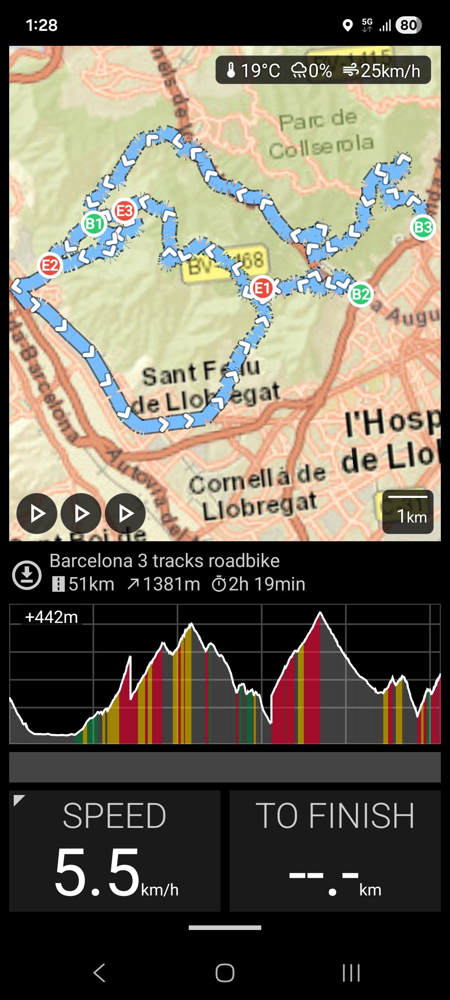
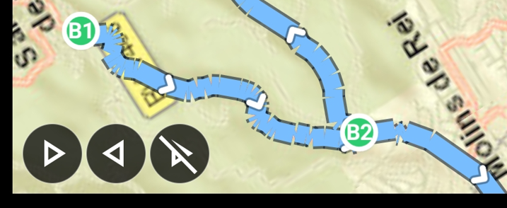
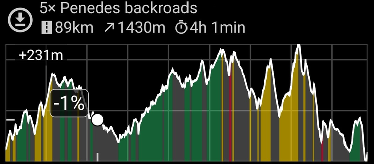
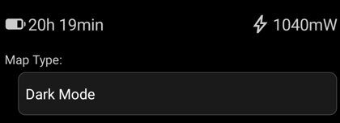

Cyclope is a mobile phone app designed to help cyclists navigate using GPX paths. Cyclope
uses an open-source map service and combines gpx track guidance with weather forecasts.

  

## Main Features

<table width="100%" cellpadding="4" style="max-width: 560px; margin-left: auto; margin-right: auto;">
   <tr>
      <td width="35%"></td>
      <td valign="middle">Air temperature, rain probability and wind speed prediction in real time.</td>
   </tr>
   <tr>
      <td width="35%"></td>
      <td valign="middle">Shows useful points of interest along the route.</td>
   </tr>
   <tr>
      <td width="35%"></td>
      <td valign="middle">Load GPX files with multiple tracks that can be easily reordered via dragging and tapping.</td>
   </tr>
   <tr>
      <td width="35%"></td>
      <td valign="middle">Monitor current speed, elevation and lapsed distance while riding.</td>
   </tr>
   <tr>
      <td width="35%"></td>
      <td valign="middle">Instant elevation and climb information along all multiple tracks.</td>
   </tr>
   <tr>
      <td width="5%"></td>
      <td valign="middle">Dark maps give 20+ hours of battery life with 100% screen brightness.</td>
   </tr>
</table>

Running on your Android phone, Cyclope is designed to optimize power consumption so that, on an average phone, you can enjoy **15+ hours of battery time**.

<h3 align="center"><a href="https://raw.githubusercontent.com/fabriziotappero/cyclope/main/releases/Cyclope_v1.3.3.apk" download="Cyclope_v1.3.3.apk">DOWNLOAD LATEST VERSION</a></h3>

## License

Cyclope's original source code is licensed under the Apache License 2.0; see
[LICENSE](LICENSE). That license does not apply to third-party services, their
data, or bundled GPX files unless their respective owners separately grant those
rights.

- OpenStreetMap data used for points of interest is © OpenStreetMap contributors
   and available under the [ODbL 1.0](https://www.openstreetmap.org/copyright).
   Credit OpenStreetMap and make the ODbL license available when displaying or
   redistributing that data.
- Map tiles are served by Esri ArcGIS services. Their source credits and terms
   vary by selected layer; the app displays the selected layer's attribution.
   See [Esri terms](https://www.esri.com/en-us/legal/terms/full-master-agreement)
   and the corresponding [ArcGIS basemap service](https://server.arcgisonline.com/ArcGIS/rest/services/).
- Weather data is provided by Open-Meteo under
   [CC BY 4.0](https://creativecommons.org/licenses/by/4.0/). Credit Open-Meteo
   and link the license. The free API is for non-commercial use only; commercial
   use requires an eligible Open-Meteo subscription. See
   [Open-Meteo's terms](https://open-meteo.com/en/terms).
- The bundled default GPX route is a separate work. Its inclusion here does not
   grant permission to redistribute that route; check its source and rights
   before republishing it.
