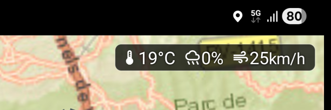
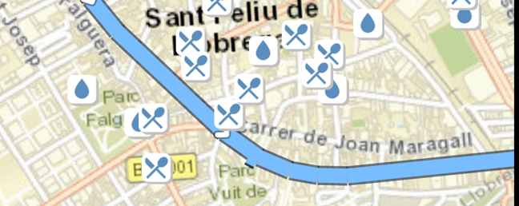
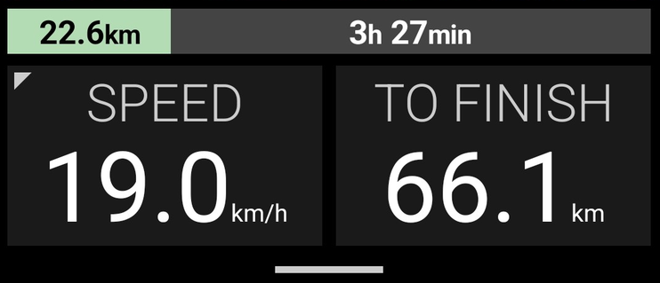

Cyclope is a mobile phone app designed to help cyclists navigate using GPX paths. Cyclope
uses an open-source map service and combines gpx track guidance with weather forecasts.

<p align="center">
  
</p>

Cyclope main features:
 - Load your GPX track and get a quick overview: track on the map, length, cumulative ascent, duration.
 - Accurate riding directions with useful points of interest like water sources and restaurants.
 - Several types of maps can be chosen from the Options panel.
 - While riding along the GPX track, you get current speed/altitude, ridden distance as well as distance to destination.
 - Real-time weather information like current temperature, wind speed and rain forecast.

Running on your Android phone, Cyclope is designed to optimize power consumption so that, on an average phone, you can enjoy **15+ hours of battery time**.

## Features

<table cellpadding="12">
   <tr>
      <td><span>Air temperature, rain probability and wind speed prediction.</span></td>
      <td><span>Shows useful points of interest along the route.</span></td>
   </tr>
   <tr>
      <td><span>Load GPX files with multiple tracks that can be easily reordered via dragging and tapping.</span></td>
      <td><span>Monitor current speed, elevation and lapsed distance while riding.</span></td>
   </tr>
   <tr>
      <td><span>Follow climbs and elevation information.</span></td>
      <td></td>
   </tr>
</table>

The following sections show a simple setup to build Cyclope with Android SDK tools and install the compiled APK on your phone. This is done using WSL or Linux.

## Prerequisites

- WSL/Linux shell
- Java 17+
- `wget`, `unzip`, `python3`

Except for the actual copy of the .apk program to your phone, the build process is done in Linux.

If Java is missing, open your Linux terminal and:

```sh
sudo apt update
sudo apt install -y openjdk-17-jdk
```

---

## Install Android SDK Command-line Tools

```sh
mkdir -p ~/android-sdk/cmdline-tools
cd ~/android-sdk/cmdline-tools

wget https://dl.google.com/android/repository/commandlinetools-linux-11076708_latest.zip
unzip commandlinetools-linux-11076708_latest.zip
mv cmdline-tools latest
rm commandlinetools-linux-11076708_latest.zip
```

---

## Configure environment variables

Add this to `~/.bashrc`:

```sh
echo 'export ANDROID_SDK_ROOT=$HOME/android-sdk' >> ~/.bashrc
echo 'export ANDROID_HOME=$ANDROID_SDK_ROOT' >> ~/.bashrc
echo 'export PATH=$PATH:$ANDROID_SDK_ROOT/cmdline-tools/latest/bin:$ANDROID_SDK_ROOT/platform-tools' >> ~/.bashrc
source ~/.bashrc
```

---

## Install Android SDK packages

```sh
yes | sdkmanager --licenses
sdkmanager "platforms;android-34" "build-tools;34.0.0" "platform-tools"
```

---

## Build the app

From the project folder:

```sh
cd /mnt/c/WORK/03_PERSONAL/google/cyclope
./gradlew assembleDebug --warning-mode all
```

APK output:

```text
app/build/outputs/apk/debug/Cyclope-debug.apk
```

### Debug vs release

| | Debug | Release |
|---|---|---|
| Command | `./gradlew assembleDebug` | `./gradlew assembleRelease` |
| Output | `app/build/outputs/apk/debug/Cyclope-debug.apk` | `app/build/outputs/apk/release/Cyclope-release.apk` |
| Log file `Downloads/cyclope_log.txt` | written | not written (logcat only) |
| Signed with | automatic debug key | your own release key (see below) |

Use debug while developing and testing, release for riding.

### Build a release APK using Linux under WSL

Android only installs signed APKs. The release build is signed with your own key,
created once and kept safe: **if you lose it, you can only install a new release
after uninstalling the app** (which deletes its data, e.g. the recent GPX list).

1. Create the key once (choose your own passwords; keep the file outside the repo):

   ```sh
   mkdir -p ~/keys
   keytool -genkeypair -v -keystore ~/keys/cyclope-release.jks -alias cyclope \
       -keyalg RSA -keysize 2048 -validity 10000
   ```

2. Create `keystore.properties` in the project root (it is in `.gitignore`, never commit it):

   ```properties
   storeFile=/home/<user>/keys/cyclope-release.jks
   storePassword=<store password>
   keyAlias=cyclope
   keyPassword=<key password>
   ```

3. Build:

   ```sh
   ./gradlew assembleRelease
   ```

   Without `keystore.properties` the build still works but produces
   `Cyclope-release-unsigned.apk`, which cannot be installed.

**Switching between debug and release on the phone:** both use the same app id but
different keys, so Android refuses to install one over the other
(`INSTALL_FAILED_UPDATE_INCOMPATIBLE`). Uninstall first (`adb uninstall com.fab.cyclope`),
which deletes the app data.

---

## Install APK on phone via USB cable

Enable Developer Options + USB debugging on your phone, then connect your phone to your PC using a USB cable. Copy to the phone *Cyclope-debug.apk* and from the phone double click on it and install. Or better use *adb*.

---

## Install and use adb from Windows PowerShell

To copy the .apk to my phone using **adb**, Windows PowerShell seems to give less problems.

```sh
winget install Google.PlatformTools

adb.exe kill-server
adb.exe start-server
adb.exe devices

adb install -r "app\build\outputs\apk\debug\Cyclope-debug.apk"
# or, for a release build:
adb install -r "app\build\outputs\apk\release\Cyclope-release.apk"
```

## Troubleshooting

#### JAVA_HOME is not set

```sh
export JAVA_HOME=/usr/lib/jvm/java-17-openjdk-amd64
export PATH=$JAVA_HOME/bin:$PATH
```

(Then add to `~/.bashrc` if needed.)

#### sdkmanager: command not found

Check:

```sh
echo $ANDROID_SDK_ROOT
ls $ANDROID_SDK_ROOT/cmdline-tools/latest/bin
```

If the folder is correct, reload shell:

```sh
source ~/.bashrc
```

## License and data sources

Cyclope's original source code is licensed under the Apache License 2.0; see
[LICENSE](LICENSE). That license does not apply to third-party services, their
data, or bundled GPX files unless their respective owners separately grant those
rights.

- OpenStreetMap data used for points of interest is © OpenStreetMap contributors
   and available under the [ODbL 1.0](https://www.openstreetmap.org/copyright).
   Credit OpenStreetMap and make the ODbL license available when displaying or
   redistributing that data.
- Map tiles are served by Esri ArcGIS services. Their source credits and terms
   vary by selected layer; the app displays the selected layer's attribution.
   See [Esri terms](https://www.esri.com/en-us/legal/terms/full-master-agreement)
   and the corresponding [ArcGIS basemap service](https://server.arcgisonline.com/ArcGIS/rest/services/).
- Weather data is provided by Open-Meteo under
   [CC BY 4.0](https://creativecommons.org/licenses/by/4.0/). Credit Open-Meteo
   and link the license. The free API is for non-commercial use only; commercial
   use requires an eligible Open-Meteo subscription. See
   [Open-Meteo's terms](https://open-meteo.com/en/terms).
- The bundled default GPX route is a separate work. Its inclusion here does not
   grant permission to redistribute that route; check its source and rights
   before republishing it.
